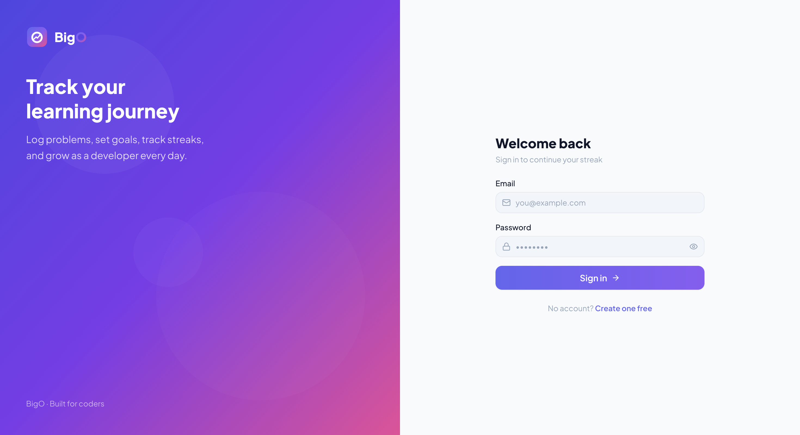
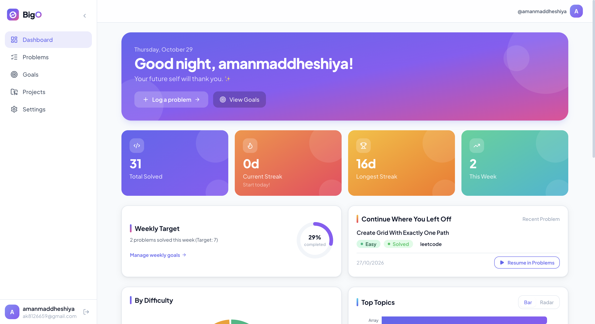

# BigO

> Code daily. Track everything. Share your journey.

A MERN full-stack app to track your coding practice: log solved problems, watch
streaks and charts grow, set goals, showcase projects, sync Codeforces/LeetCode
solves, and share a public profile.

## 📸 Screenshots

🖥️ Login Page

<div align="center">
  
</div>

📝 Dashboard

<div align="center">
  
</div>

## Features

- **Auth** — register/login with short-lived JWT access tokens (15 min) +
  httpOnly refresh cookies (7 days), bcrypt hashing, auto-refresh interceptor.
- **Problem logging** — CRUD with filters (difficulty, topic, status, date
  range) and pagination. Everything is scoped to the logged-in user.
- **Stats & streaks** — streaks computed from solve dates in your timezone
  (never stored); overview cards, difficulty donut, topic bars, weekly line
  chart, GitHub-style activity heatmap.
- **Goals** — CRUD; progress computed live on every read (problems matched by
  filter/date range, current streak, or project count).
- **Projects** — CRUD with stack tags, repo/live links, learnings, featured flag.
- **Platform sync** — one-click Codeforces + LeetCode import with upsert (no
  duplicates), per-user cooldown, daily cron job. Manual logging always works
  even if both platforms are down.
- **Public profiles** — opt-in `/u/:username` page with per-section privacy
  flags; never leaks email, password hash, or timezone.

## Tech stack

| Layer  | Tech |
| ------ | ---- |
| Server | Node.js, Express, Mongoose, JWT, Zod, helmet, cors, express-rate-limit, node-cron, axios, bcryptjs, cookie-parser, dotenv |
| Client | React + Vite, React Router, Axios, Recharts, Tailwind CSS |
| Tests  | Jest + Supertest (+ mongodb-memory-server) |
| CI     | GitHub Actions (install → lint → test only, no deploy step) |

## Setup

Prerequisites: Node 20+, a MongoDB instance (local `mongod` or Atlas).

```bash
# 1. Server
cd server
cp .env.example .env   # fill in values (see table below)
npm install
npm run dev            # http://localhost:5000

# 2. Client (new terminal)
cd client
cp .env.example .env   # set VITE_API_URL=http://localhost:5000/api
npm install
npm run dev            # http://localhost:5173
```

Run tests: `npm test` inside `server/`.

## Environment variables

### Server (`server/.env`)

| Variable | Required | Description |
| -------- | -------- | ----------- |
| `PORT` | yes | Port the API listens on (e.g. `5000`) |
| `MONGODB_URI` | yes | MongoDB connection string |
| `JWT_ACCESS_SECRET` | yes | Secret for 15-min access tokens |
| `JWT_REFRESH_SECRET` | yes | Secret for 7-day refresh tokens |
| `CLIENT_URL` | yes | Frontend origin for CORS (e.g. `http://localhost:5173`) |
| `NODE_ENV` | yes | `development` or `production` (controls cookie `secure`/`sameSite`) |

The server fails fast on startup with a clear message if any variable is
missing. Never commit `.env` — only `.env.example` (empty values) is tracked.

### Client (`client/.env`)

| Variable | Required | Description |
| -------- | -------- | ----------- |
| `VITE_API_URL` | yes | Base API URL (e.g. `http://localhost:5000/api`) |

## API overview

All responses are `{ message, errors? }` on errors. Authenticated routes take
`Authorization: Bearer <accessToken>`.

| Method & path | Auth | Description |
| ------------- | ---- | ----------- |
| `POST /api/auth/register` | no | Register (rate-limited, Zod-validated) |
| `POST /api/auth/login` | no | Login |
| `POST /api/auth/refresh` | cookie | Rotate tokens |
| `POST /api/auth/logout` | no | Clear refresh cookie |
| `GET/PATCH /api/auth/me` | yes | Current user / update profile & handles |
| `GET/POST /api/problems` | yes | List (filters + pagination) / create |
| `GET/PUT/DELETE /api/problems/:id` | yes | Read / update / delete (owner only) |
| `GET /api/stats/overview` | yes | Totals, streaks, this-week |
| `GET /api/stats/heatmap?year=` | yes | Per-day solve counts |
| `GET /api/stats/topics` | yes | Topic counts |
| `GET /api/stats/weekly?weeks=` | yes | Solved per week |
| `GET /api/stats/difficulty` | yes | Counts by difficulty |
| `GET/POST /api/goals`, `GET/PUT/DELETE /api/goals/:id` | yes | Goals (progress computed on read) |
| `GET/POST /api/projects`, `GET/PUT/DELETE /api/projects/:id` | yes | Projects |
| `POST /api/sync/:platform` | yes | Sync `codeforces`/`leetcode` (cooldown) |
| `GET /api/sync/status` | yes | Last-sync stats per platform |
| `GET /api/public/:username` | no | Public profile (404 if private; rate-limited) |

## Deployment

- **Client** — deploy `client/` on Vercel. `client/vercel.json` contains the SPA
  rewrite (`/(.*)` → `/index.html`) so React Router routes work on refresh.
- **Server** — deploy `server/` on **Render or Railway** (Node service with the
  env vars above plus a MongoDB Atlas `MONGODB_URI`). The daily sync cron runs
  inside the server process, so no extra worker is needed.
